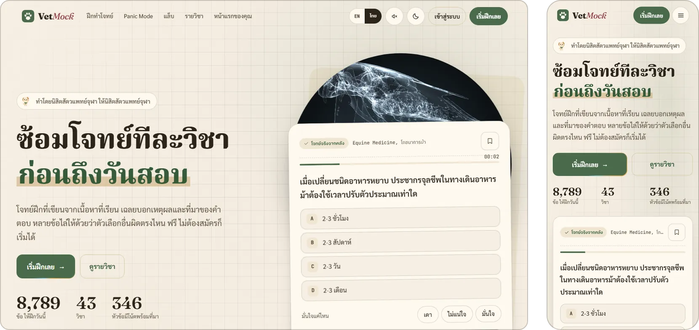
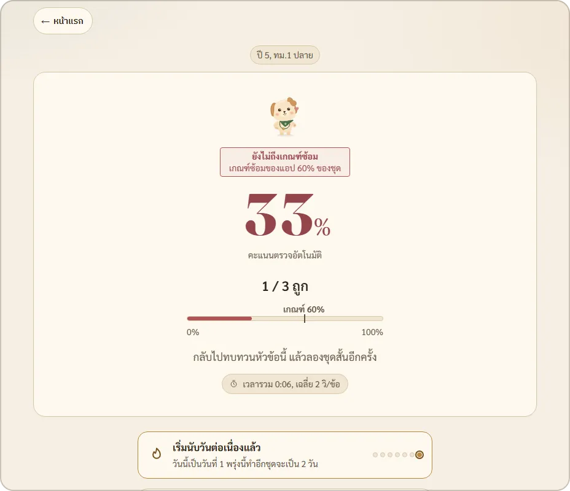
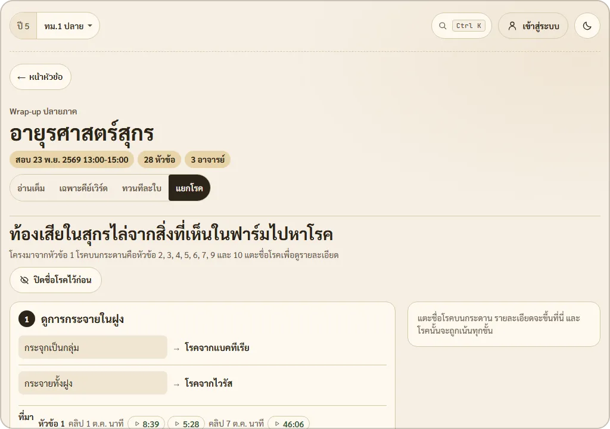
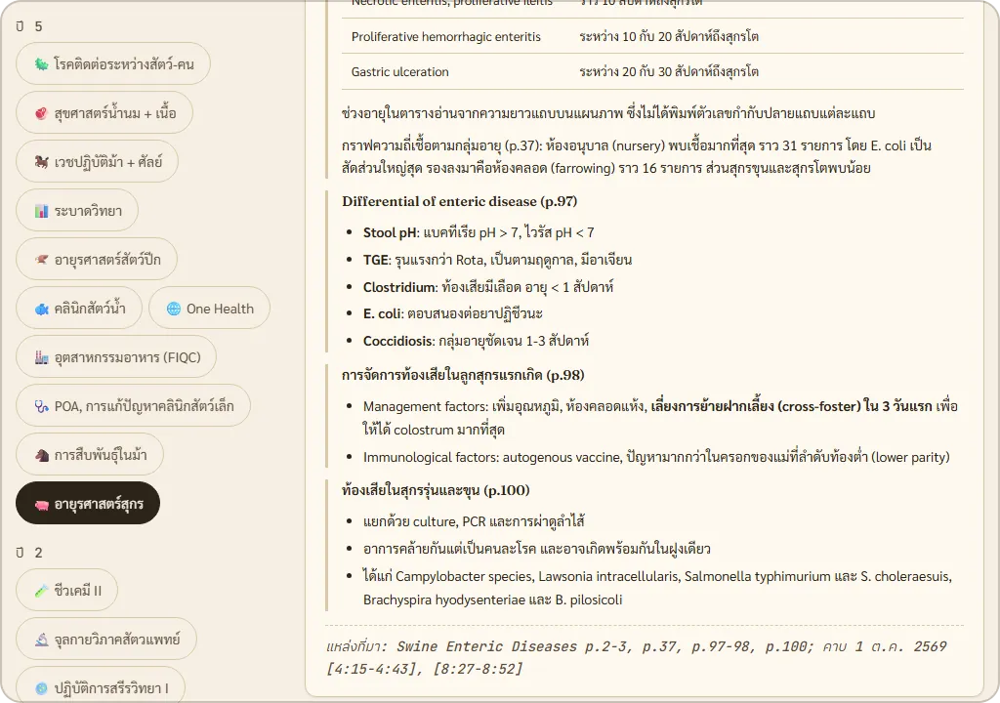
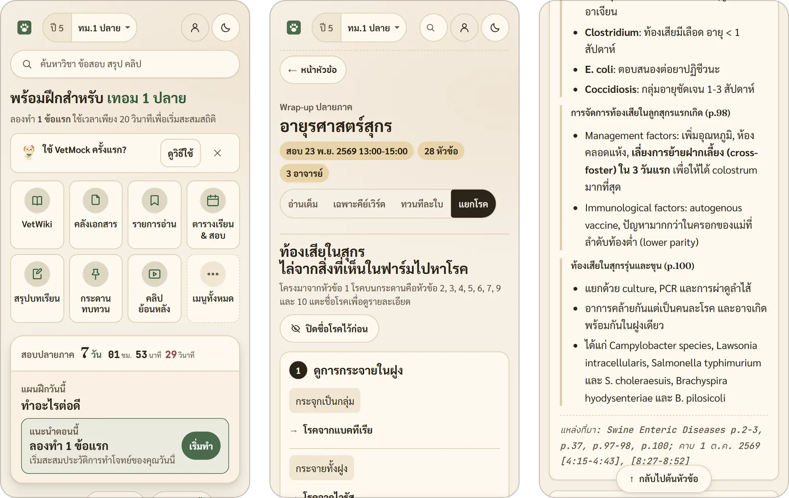

<p align="center">
  
</p>

<h1 align="center">VetMock</h1>

<p align="center">
  <b>ซ้อมโจทย์ทีละวิชา ก่อนถึงวันสอบ</b><br>
  Practice questions, wrap-ups and notes for veterinary students at Chulalongkorn University.
</p>

<p align="center">
  <a href="https://vetmock.com">vetmock.com</a> &nbsp;|&nbsp; <a href="README.th.md">ภาษาไทย</a> &nbsp;|&nbsp;
  <a href="https://github.com/palmzamak2547/vet-mock/actions/workflows/build.yml"></a>
</p>

<picture>
  <source media="(prefers-color-scheme: dark)" srcset="docs/readme/hero-dark.webp">
  
</picture>

## What it does

**Practice with the reason attached.** Pick a subject and a topic, answer, and see the answer with why each option is right or wrong. Sets can be timed, and wrong answers come back for review.

<picture>
  <source media="(prefers-color-scheme: dark)" srcset="docs/readme/results-dark.webp">
  
</picture>

**A wrap-up before each paper.** Each subject has one page to read before its paper: the points in order, with a board that sets diseases side by side.

<picture>
  <source media="(prefers-color-scheme: dark)" srcset="docs/readme/wrapup-dark.webp">
  
</picture>

**Notes that show their source.** Every section of a note says where it comes from. The VetWiki turns those notes into articles that can be linked.

<picture>
  <source media="(prefers-color-scheme: dark)" srcset="docs/readme/notes-dark.webp">
  
</picture>

**Phone first.** Home with the countdown to the next paper, a wrap-up and a note, each built for one hand.

<picture>
  <source media="(prefers-color-scheme: dark)" srcset="docs/readme/phone-dark.webp">
  
</picture>

Also in the app: the weekly timetable and exam dates, a document library, lecture clip summaries, spaced review, and sign-in for faculty accounts. Everything except cloud sync works without an account.

## How it is made


What keeps it correct, each checkable in this repository:

- Every pull request runs the data lints, the unit tests in Bangkok time and UTC, a production build and end-to-end tests on Chromium, Firefox, WebKit and a phone profile ([`.github/workflows`](.github/workflows)).
- A question that cannot be verified is held back from students and counted separately.
- Each citation is stored as written and shown in a form a student can read.
- Contrast, bundle size and the design of each screen have a check or a written gate ([`STABILITY.md`](STABILITY.md), [`docs/DESIGN_SYSTEM.md`](docs/DESIGN_SYSTEM.md)).

## Numbers

Generated from the source by `npm run stats -- --write`; `npm run stats:check` fails when they drift. Full table: [`docs/content-inventory.md`](docs/content-inventory.md).

<!-- content-stats:start -->
| | |
|---|---|
| ข้อสอบพร้อมฝึก | **8,996 ข้อ** ใน 108 bank files, 43 วิชา |
| พักไว้เพื่อความถูกต้อง | 212 ข้อรอตรวจเฉลย ขอบเขต หรือภาพประกอบ (เก็บใน source bank แต่ไม่ส่งให้ผู้เรียน) |
| ชั้นปีที่มีเนื้อหา | ปี 1 (297), ปี 2 (144), ปี 3 (62), ปี 4 (2,076), ปี 5 (6,417) |
| สรุปโน้ต | 39 ไฟล์, 431 หัวข้อ, 4,605 sections, อ้างอิงแหล่งที่มาครบ 100% |
| สรุปคลิป | 644 คลิป ใน 32 ไฟล์ |
| VetWiki (governed) | 253 หัวข้อ, 2,279 sections = 49.5% ของ note sections |
| Taxonomy | 86 วิชา, 1,086 หัวข้อ |
| ชนิดคำถาม | MCQ, True/False, Fill-in, Matching, Short answer, Writing |
<!-- content-stats:end -->

## Run it and contribute

```bash
npm install
npm run dev        # http://localhost:5173, works on localStorage with no setup
npm run build      # production build
npm run test:unit  # the contract tests
npm run lint:all   # the data and content checks
```

Accounts, study groups and cloud sync need Supabase: see [`SETUP.md`](SETUP.md). Read [`AGENTS.md`](AGENTS.md) before changing anything; it holds the rules. Work in flight is claimed in [issue #253](https://github.com/palmzamak2547/vet-mock/issues/253). Adding questions: [`ADDING-QUESTIONS.md`](ADDING-QUESTIONS.md).

Found a mistake or have an idea? Use the Feedback page in the app or [open an issue](https://github.com/palmzamak2547/vet-mock/issues).

## Credits

Made by Vet 86. Brand marks on the connected-apps page belong to their owners ([`public/brand/ATTRIBUTION.md`](public/brand/ATTRIBUTION.md)). Type: Sarabun under the SIL Open Font License ([`public/Sarabun/OFL.txt`](public/Sarabun/OFL.txt)) and Fraunces. Motion kit licences: [`docs/licenses`](docs/licenses). The repository has no licence file for its own code or content: ask in an issue before reusing it.

The pictures above are of the running app with test data, refreshed by hand when screens change.
