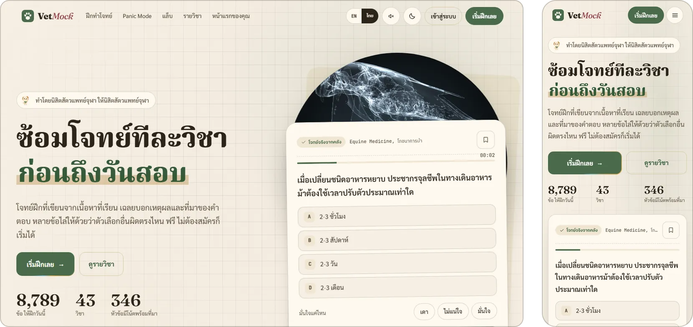
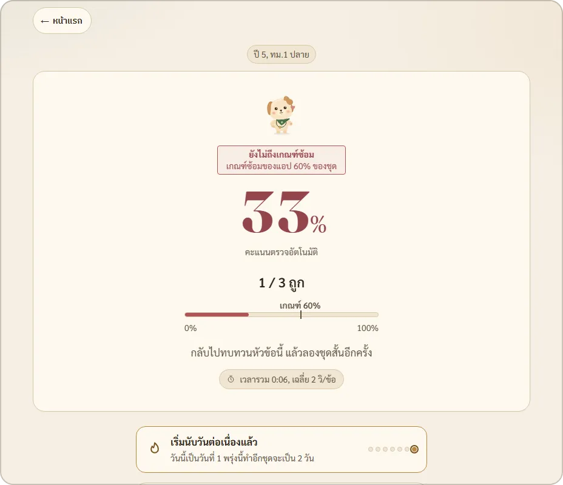
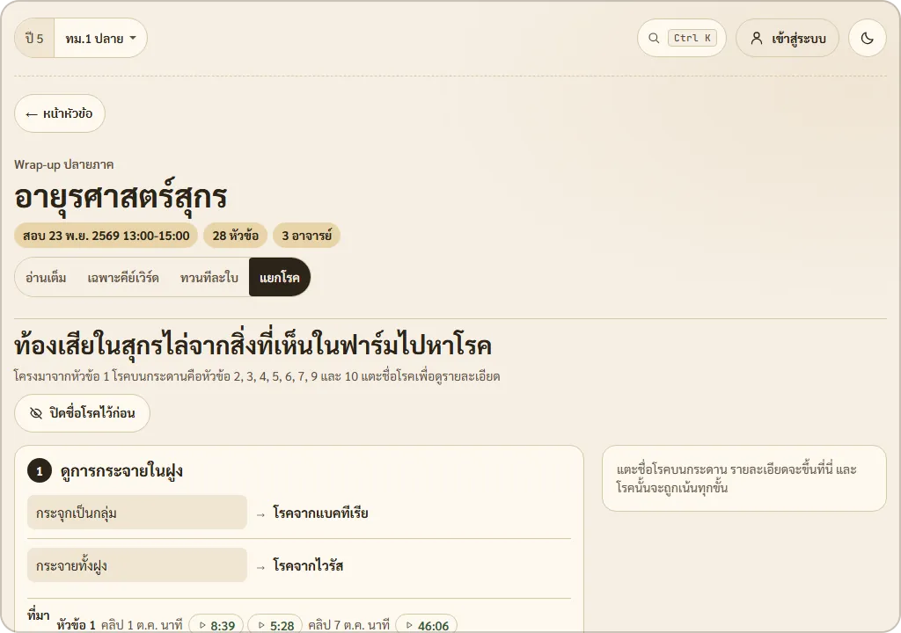
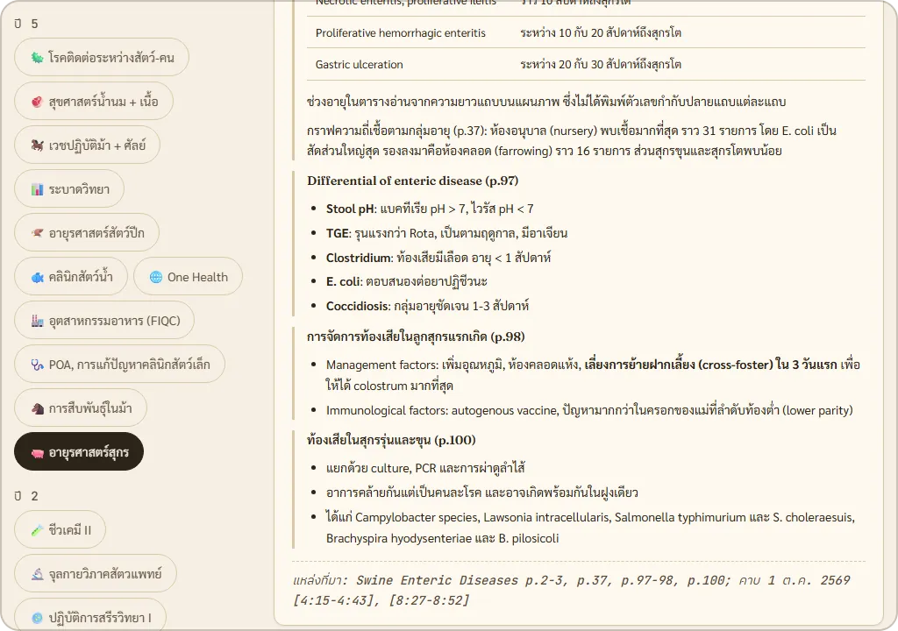
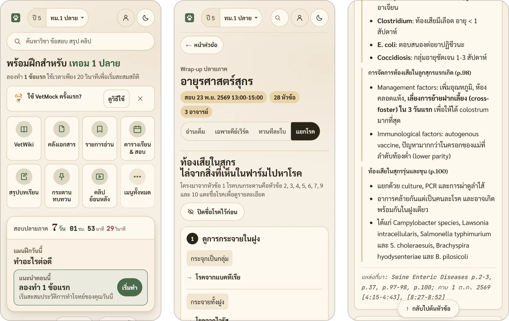

<p align="center">
  
</p>

<h1 align="center">VetMock</h1>

<p align="center">
  <b>ซ้อมโจทย์ทีละวิชา ก่อนถึงวันสอบ</b><br>
  โจทย์ สรุปก่อนสอบ และโน้ต สำหรับนิสิตสัตวแพทย์ จุฬาลงกรณ์มหาวิทยาลัย
</p>

<p align="center">
  <a href="https://vetmock.com">vetmock.com</a> &nbsp;|&nbsp; <a href="README.md">English</a> &nbsp;|&nbsp;
  <a href="https://github.com/palmzamak2547/vet-mock/actions/workflows/build.yml"></a>
</p>

<picture>
  <source media="(prefers-color-scheme: dark)" srcset="docs/readme/hero-dark.webp">
  
</picture>

## ใช้ทำอะไรได้

**ฝึกโจทย์ พร้อมเหตุผล** เลือกวิชาและหัวข้อ ตอบ แล้วดูเฉลยพร้อมเหตุผลว่าแต่ละตัวเลือกถูกหรือผิดเพราะอะไร จับเวลาได้ และข้อที่ตอบผิดจะวนกลับมาทบทวน

<picture>
  <source media="(prefers-color-scheme: dark)" srcset="docs/readme/results-dark.webp">
  
</picture>

**สรุปก่อนสอบ** แต่ละวิชามีหน้าสรุปหน้าเดียวให้อ่านก่อนสอบ เรียงตามประเด็น มีบอร์ดเทียบโรคเคียงกัน

<picture>
  <source media="(prefers-color-scheme: dark)" srcset="docs/readme/wrapup-dark.webp">
  
</picture>

**โน้ตที่บอกแหล่งที่มา** ทุกส่วนของโน้ตบอกว่ามาจากไหน และ VetWiki ต่อยอดจากโน้ตเหล่านั้นเป็นบทความที่แชร์ลิงก์ได้

<picture>
  <source media="(prefers-color-scheme: dark)" srcset="docs/readme/notes-dark.webp">
  
</picture>

**เปิดบนมือถือได้เลย** หน้าแรกที่นับถอยหลังถึงวันสอบ หน้าสรุป และโน้ต จัดให้ใช้มือเดียว

<picture>
  <source media="(prefers-color-scheme: dark)" srcset="docs/readme/phone-dark.webp">
  
</picture>

ยังมีตารางเรียนและวันสอบ คลังเอกสาร สรุปคลิปเรียน ทบทวนตามช่วงเวลา และเข้าสู่ระบบด้วยบัญชีของคณะ ทุกอย่างยกเว้นการซิงก์ข้อมูลใช้ได้โดยไม่ต้องมีบัญชี

## สร้างมาอย่างไร


สิ่งที่ทำให้เนื้อหาถูกต้อง ตรวจได้ใน repository นี้

- ทุก pull request ผ่านการตรวจข้อมูล unit test ทั้งเวลากรุงเทพและ UTC การ build และ end-to-end บน Chromium, Firefox, WebKit และโปรไฟล์มือถือ ([`.github/workflows`](.github/workflows))
- ข้อที่ยังตรวจไม่ได้จะไม่ถูกส่งให้นิสิต และนับแยกไว้
- การอ้างอิงเก็บตามที่เขียนไว้ แล้วแสดงในรูปที่อ่านเข้าใจ
- สี ขนาด bundle และดีไซน์ของแต่ละหน้ามีการตรวจหรือเกณฑ์ที่เขียนไว้ ([`STABILITY.md`](STABILITY.md), [`docs/DESIGN_SYSTEM.md`](docs/DESIGN_SYSTEM.md))

## ตัวเลข

ตัวเลขทั้งหมดสร้างจากข้อมูลจริงด้วย `npm run stats -- --write` จึงไม่พิมพ์ซ้ำที่นี่ ดูตารางที่ [README.md](README.md#numbers) และตารางเต็มที่ [`docs/content-inventory.md`](docs/content-inventory.md)

## รันและร่วมพัฒนา

```bash
npm install
npm run dev        # http://localhost:5173 ใช้ได้ทันทีด้วย localStorage
npm run build
npm run test:unit
npm run lint:all
```

บัญชี กลุ่มติว และการซิงก์ต้องใช้ Supabase ดู [`SETUP.md`](SETUP.md) อ่าน [`AGENTS.md`](AGENTS.md) ก่อนแก้ไขอะไร เพราะเป็นที่รวมกติกา งานที่กำลังทำอยู่จองไว้ที่ [issue #253](https://github.com/palmzamak2547/vet-mock/issues/253) การเพิ่มโจทย์ดู [`ADDING-QUESTIONS.md`](ADDING-QUESTIONS.md)

เจอข้อผิดพลาดหรือมีไอเดีย ใช้หน้า Feedback ในแอป หรือ [เปิด issue](https://github.com/palmzamak2547/vet-mock/issues)

## เครดิต

จัดทำโดย Vet 86 เครื่องหมายของแอปที่เชื่อมต่อเป็นของเจ้าของแต่ละราย ([`public/brand/ATTRIBUTION.md`](public/brand/ATTRIBUTION.md)) ฟอนต์ Sarabun ใช้ตามสัญญาอนุญาต SIL Open Font License ([`public/Sarabun/OFL.txt`](public/Sarabun/OFL.txt)) และ Fraunces สัญญาอนุญาตของชุดภาพเคลื่อนไหวอยู่ที่ [`docs/licenses`](docs/licenses) repository นี้ไม่มีไฟล์สัญญาอนุญาตสำหรับโค้ดและเนื้อหาของตัวเอง ถ้าจะนำไปใช้ซ้ำ ให้ถามผ่าน issue ก่อน

ภาพประกอบเป็นภาพของแอปที่ทำงานจริงด้วยข้อมูลทดสอบ และอัปเดตด้วยมือเมื่อหน้าจอเปลี่ยน
